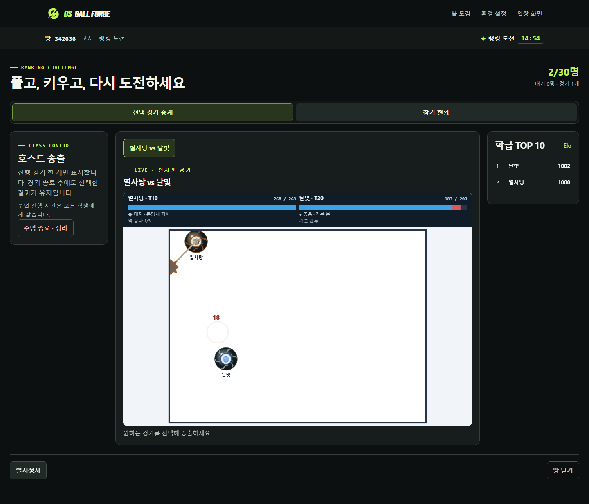

# YeomBallForge v2.1 구현 검증

검증일: 2026-11-26 (Asia/Seoul). 기준은 원격 `main`의 `d6967bc22e8710bb296c47ee65916cbd4fa3ad6d`, 작업 브랜치는 `feat/v2.1-ranking-tactics`이다. 확인된 기존 v1.1 위에 구현했으며 과거 커밋으로 되돌리지 않았다. **이 문서는 개발 브랜치 검증이며 운영 배포 확인서가 아니다.**

## 변경 범위

- 서버 권위 랭킹 수업, 독립 3슬롯과 공유 지갑, 반복 퀴즈, 원자적 강화·선택·매칭, Elo, 종료 정리와 재접속.
- 정확한 v2.1 경제, 모든 단계 실패 가능, 상위 실패 초기화, 목표 티어별 유지권 1/2/3개, 결과 확인 뒤 선택.
- 50개 전투 프로필/508개 폼/기존 26개 초상화, 10개 특성과 프로필별 고정 호환 3개, 수업 팩과 개인 목표.
- 분리 넉백·원인 사건, 파란 HP/빨간 피해 잔상, 구체/초상화/혼합, 재질별 합성음, 표시 부하·히트스톱 상한.
- 최근 3경기의 서버 기록 재생, 보상 없는 비교 연습, 공통 시뮬레이터의 6초 능력 시연, 오프라인 CPU 반복 연습.
- 다음 티어 미리보기·합법적인 같은 계열 선택, 슬롯 필터, 실패 후 복귀 행동과 자동 확정 결과 표시.

## 전체 테스트

`npm test`: **102 PASS**, 실패·취소·skip 0. 실제 HTTP/소켓·역할 격리·멱등성·복구·경제 경계·전투 결정성·특성·화면 시간축을 검사한다. 종료 정리에서는 실제 남은 선택만 허용하는 회귀 검사도 포함한다. 마지막 수정 뒤 실행한 결과는 [원본 로그](evidence-v2.1/tests.txt)를 따른다.

첫 제한 환경 실행은 loopback 연결이 `EACCES`로 차단됐다. 같은 코드와 명령을 로컬 네트워크가 허용된 실행에서 다시 검증했다. 이를 게임 테스트 실패나 공개 서버 성공으로 바꾸어 해석하지 않는다.

## 정적 빌드

`npm run build`: **PASS**. 버전 2.1.0, 공유 콘텐츠·프로토콜·시뮬레이터 모듈을 포함한 `dist` 생성. `BALLFORGE_WS_URL` 미설정이므로 빌드는 연습 가능/교실 서버 미설정 상태다. 정적 빌드 성공은 AWS WSS 연결 검증이 아니다.

`git diff --check`: **PASS**. 브라우저 모듈 그래프와 서버 정적 허용 목록도 대조했다. PR용 `Validate changes` 워크플로는 test/build만 수행하며 Pages 게시 권한이 없다.

## 실제 브라우저

개발 PC의 headless Chromium, 실제 로컬 WebSocket 서버, 서로 분리된 교사·학생 2개 브라우저 컨텍스트를 사용했다. [검사 원본과 화면 목록](evidence-v2.1-browser/report.json).

| 검사 | 결과 |
|---|---|
| 교사 인증·방 생성·학생 2명 참가·기본 10장 | PASS |
| 정답 +2, 랭킹 갱신 중 문제 DOM·답안·스크롤 보존 | PASS |
| 실제 강화 비용, 결과 먼저 표시, 무료 3슬롯·보관 잠금 | PASS |
| T10 성공 → 재접속 → 경로·공·특성 선택 | PASS, 고급 단계는 배치한 fixture |
| 학생 실제 경기·호스트 중계·학생 자기 HUD·백그라운드 퀴즈 | PASS |
| 실제 경기 원본 해시·상태 재생, 비교 연습 인벤토리 불변 | PASS |
| 대표 8개 실제 시뮬레이터 시연 | PASS, 준비 상황을 표시한 시연 |
| 종료 정리와 RESULTS | PASS |

1920×1080, 1440×900, 1280×720, 1024×768, 844×390, 390×844에서 수평 넘침을 검사했다. 브라우저 오류 0. 고급 성공·실패·자동 확정 검사는 의도적으로 상태를 배치했으며 자연적인 수업 도달률을 측정한 것이 아니다.

- [추가 선택·복귀 흐름 검사 10개](v2.1-forge-flow.md): 다음 후보, 필터, 초기화→결과 확인→보관 공 출전, 자동 확정, 다시 도전, 늦은 응답, 무효 결과, T1 표시, 학생 이름 HTML 삽입 방지.
- [리플레이 수명 검사 6개](evidence-v2.1-replay/report.json): 배속 후 탐색/재시작, 열린 창 교체, 닫기 정리, 늦은 해시 응답 취소, 기록 손상 거절.
- [오프라인 연습 검사 5개](v2.1-practice.md): 반복 퀴즈·3슬롯·CPU 전투·원본 기록·복사본 비교, 1440×900/390×844, 오류 0.

## 화면 증거

### 호스트 송출과 학생 성장



[성공이 선택보다 먼저 표시됨](evidence-v2.1-browser/04-success-before-choice.png) · [T10 특성 선택 완료](evidence-v2.1-browser/05-t10-ready-mobile.png) · [원본 리플레이](evidence-v2.1-browser/08-original-replay-mobile.png) · [비교 연습](evidence-v2.1-browser/09-comparison-mobile.png)

### 대표 8개 시연

시연은 실제 공통 규칙에서 시작 위치·충전·첫 준비시간을 배치한 6초 상황이다. 일반 경기에서 항상 6초 안에 발동하거나 이긴다는 뜻이 아니다. 모든 50개 프로필의 실제 사건 검사는 [전투 자료](v2.1-combat-analysis.json)에 있다.

| 철퇴 | 연속 검격 | 방패 | 차지 포격 |
|---|---|---|---|
| [장면](evidence-v2.1-browser/demo-earth-5-mace.png) | [장면](evidence-v2.1-browser/demo-blade-5-trinity.png) | [장면](evidence-v2.1-browser/demo-water-5-tide.png) | [장면](evidence-v2.1-browser/demo-common-5-beam.png) |

| 돌진 | 빙결 | 소환 | 흡수·반격 |
|---|---|---|---|
| [장면](evidence-v2.1-browser/demo-lightning-5-bolt.png) | [장면](evidence-v2.1-browser/demo-water-5-frost.png) | [장면](evidence-v2.1-browser/demo-summon-5-summoner.png) | [장면](evidence-v2.1-browser/demo-space-5-star.png) |

## 경제와 전투 분석

[경제 DP와 독립 Fraction 검산](v2.1-economy.md)은 명세의 유한 예산 A/B 결과를 재현한다. 실제 정답 속도·주의 전환·3슬롯 전략의 수업 성과로 주장하지 않는다.

[816개 실제 전투](v2.1-design.md)는 4개 고정 시드와 좌우 위치 교환을 사용했다. 평균 32.40초, 중앙 33.57초, P95 35.18초, 40초 제한 판정 0. 작은 지정 표본에서 극단적인 0/8·8/8 결과 59조합과 사역마의 일부 근접 상대 우세가 남는다. 전체 조합의 균등 밸런스가 입증된 것은 아니다.

## 서버 부하

[실측 원본](evidence-v2.1/server-load.json)과 [조건·한도](v2.1-network.md). Windows 개발 PC, Node 24.22.3, i5-1340P/16논리CPU/15.57GiB, loopback에서 서버와 31클라이언트를 한 프로세스에 두었다. 교사 1+학생 30, 최대 15동시 경기, 퀴즈·강화·재접속·기록 왕복을 겹쳐 검사했다.

명령 응답 P95 109.04ms, 서버 tick 배치 P95 0.85ms, 최고 heap 42.04MiB/RSS 138.72MiB, 개인정보 혼선 0. 럼블 30공은 별도의 최악 기믹 시나리오에서 개인 프레임 격리와 종료를 확인했다. 서버+클라이언트 합산 메모리와 순수 sim 시간을 실제 AWS 컨테이너 용량으로 해석하지 않는다.

## Canvas 표시 부하

[측정 원본](evidence-v2.1/render-load.json). 30공, 24개 신규 프로필+대표 6개, 6.5초 headless Chromium 표시. rAF와 그 안의 렌더 CPU 시간을 측정했다.

| 뷰포트·설정 | 렌더 CPU P95 | rAF 간격 P95 | 효과 최대 |
|---|---:|---:|---:|
| 1440×900, 혼합/기본 | 6.1ms | 33.3ms | 96 |
| 390×844, 구체/저사양/모션 줄임 | 2.4ms | 16.8ms | 24 |
| 844×390, 초상화/모션 줄임 | 5.2ms | 16.7ms | 96 |

이 결과는 개발 PC의 뷰포트 에뮬레이션이다. 실제 스마트폰 60FPS 달성이나 모든 학교 기기 성능을 뜻하지 않는다.

## 재현

README의 Node 명령과 함께, Playwright가 설치된 환경에서 다음을 실행한다. 선택적으로 `PLAYWRIGHT_MODULE`에 모듈 파일 절대 경로, `PLAYWRIGHT_BROWSERS_PATH` 또는 `BROWSER_EXECUTABLE`에 설치된 브라우저를 지정한다. 저장소에 Playwright 런타임 의존성을 추가하지 않았다.

```sh
node tools/browser-v21.mjs
node tools/forge-flow-v21-browser.mjs
node tools/replay-v21-browser.mjs
node tools/practice-v21-browser.mjs
node tools/render-v21-browser.mjs
```

## NOT RUN과 남은 한계

- AWS/Lightsail 기동·메모리/OOM·컨테이너 부하, 공개 WSS/HTTPS, 실제 GitHub Pages의 신규 버전 연결: **NOT RUN**. 사용자 지시에 따라 중단 상태와 운영 설정을 보존했다.
- 실물 태블릿/휴대폰 터치, Safari/Firefox, 음악·효과음 실제 청취: **NOT RUN**.
- 교사 1명+실제 학생 30명의 자연스러운 15분 수업, 학습 효과·체감 재미·자연 도달률: **NOT RUN**.
- 모든 프로필×모든 특성×티어×상성의 충분한 통계 표본: **NOT RUN**. 지정 시드 분석의 편차는 공개했다.
- 서버 재시작 후 방/리플레이 영구 복구는 제공하지 않는다. 현재 세션의 최근 3경기만 보존한다.
- main 병합, 운영 Pages 게시, Render 생성, DNS·기존 DS배틀로얄 변경은 수행하지 않았다.
