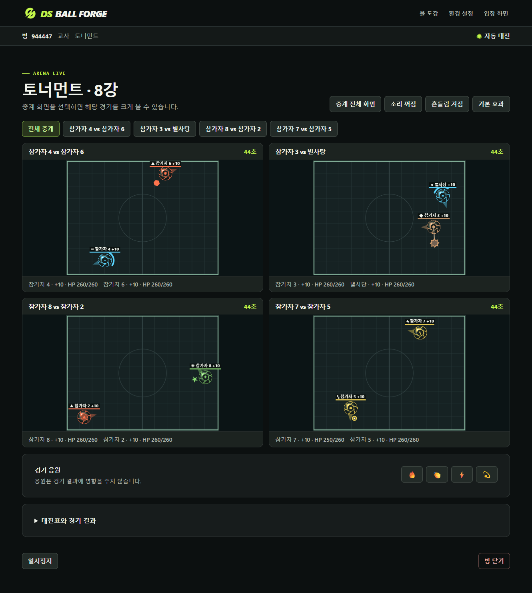

# 교사·학생 브라우저 검증

2026년 11월 25일 Windows, Node.js 24.22.3, Microsoft Edge 158.0.4370.33에서 로컬 서버에 접속했다. 교사와 학생은 서로 다른 브라우저 컨텍스트를 사용했다. 교사 뷰포트는 1330×940, 학생 뷰포트는 393×852였다. 나머지 참가자는 개별 WebSocket으로 참가·퀴즈 응답·강화·출전 확정 명령을 전송했다.

| 시나리오 | 실제 확인한 결과 | 상태 |
| --- | --- | --- |
| 교사 대기실 | 비밀번호로 방을 개설하고 QR, 코드, 참가자 수를 표시했다. TXT 예제 은행을 업로드하고 문제 미리보기와 모드·문항 수 저장을 확인했다. | PASS |
| 기본 문제은행 | 학생이 고른 오답에 대해 해당 문제의 정답과 고유 해설을 표시했다. | PASS |
| 2인 토너먼트 | 교사의 일시정지 중 학생 보기 버튼 4개가 잠겼다. 재개 후 퀴즈 8문항을 제출하고 강화권으로 +10 전직, 유지권 구매, 출전 확정까지 진행했다. | PASS |
| 재접속·결과 | 강화 중 학생 새로고침 뒤 +1을 복원했다. 교사 새로고침 뒤 운영 권한을 복원했다. 응원, 결승, 개인 기록, 같은 방 재경기 후 문제은행 유지, 방 종료를 확인했다. | PASS |
| 3인 대진 | 출전 소개에서 교사에게 실제 첫 라운드 대진과 부전승을 보여 줬다. 학생에게 자기 출전 상대 또는 부전승을 표시했다. | PASS |
| 8인 토너먼트 | 교사 화면에 4경기를 동시에 표시하고 한 경기 확대, 분할 복귀, 전체 화면 진입과 종료를 확인했다. | PASS |
| 30인 럼블 | 교사와 학생 브라우저가 같은 30명 전장을 수신했다. 모바일 화면의 자기 공 윤곽·이름·강화 단계·HP와 혼잡 시 다른 공의 간결한 HP 표시를 캡처에서 확인했다. | PASS |

## 재현

게임 의존성은 `npm ci`로 설치한다. 테스트 환경에 Playwright 및 Chromium 호환 브라우저가 필요하다. 외부 설치본을 사용할 경우 `PLAYWRIGHT_MODULE`에 Playwright의 `index.mjs` 절대 경로, `BROWSER_EXECUTABLE`에 브라우저 실행 파일의 절대 경로를 지정한다.

```sh
node tools/browser-qa.mjs
node tools/browser-qa.mjs lesson 8 30
```

번호는 해당 인원의 시나리오를 선택한다. `lesson`은 기본 문제은행 해설과 3인 대진 검사를 실행한다. 스크린샷은 `artifacts/browser`에 생성한다.

2인 시나리오는 결과와 재경기까지 진행했다. 8인·30인 화면 검사는 전투 중계를 확인한 뒤 방을 닫았다. 실기기 음질, 학교 무선망, GPU별 프레임률, 학생들의 플레이 경험은 현장 검증이 필요하다.

## 실행 화면



[학생의 강화 화면](images/student-forge.png) · [30인 럼블의 모바일 관전 화면](images/student-rumble-30.png)
